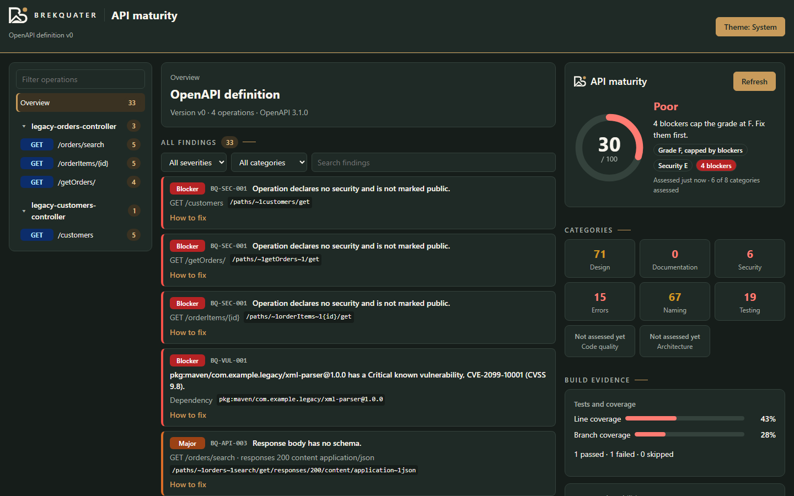

# Getting started

Add one dependency, run your Spring Boot application, open Swagger UI, and see what can be improved in your API design, plus a maturity score. It warns; it does not block, unless you turn on strict mode.



## Quick start

You need a Spring Boot 4.1 application that uses Spring MVC, and a JDK 17 or later. Add the dependency:

```xml
<dependency>
  <groupId>com.brekquater</groupId>
  <artifactId>brekquater-api-spring-boot-starter</artifactId>
  <version>0.1.0</version>
</dependency>
```

Run your application with the `dev` profile, open `http://localhost:8080/swagger-ui.html`, and click **API maturity** under the title.

## Where to go next

- [Rule catalogue](rules/index.mdx): what each of the 25 rules checks, and how to fix or suppress it.
- [Configuration](configuration.md): exposure modes, rules, scoring, report locations and strict mode.
- [Build reports](reports.md): add coverage, test results and known vulnerabilities to the assessment.

## Safe by default

The panel and the endpoints exist only in the `dev` and `local` profiles unless you configure otherwise. The starter makes no outbound network calls, sends no telemetry, and never touches your `SecurityFilterChain`.

The code is licensed under Apache-2.0; the source is on [GitHub](https://github.com/brekquater/brekquater-api-spring-boot-starter).
